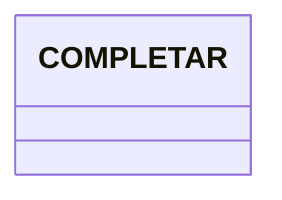

# Solución – Equipo NN – Caso X

| Campo | Valor |
|---|---|
| **Equipo** | COMPLETAR |
| **Integrantes** | COMPLETAR (nombre – usuario GitHub) |
| **Caso asignado** | COMPLETAR (por ejemplo: Caso 2 – Procesamiento de pagos) |

> Reemplaza todos los marcadores de "completar" (en mayúsculas) antes de entregar. La verificación automática rechaza la entrega si queda alguno. Puedes dejar o borrar estas notas.

---

## 1. Code smells identificados

Identifica **al menos 3** code smells. Usa los nombres del [catálogo](docs/catalogo-smells.md).

| # | Code smell | Ubicación (archivo · método · líneas) | Evidencia (¿qué síntoma concreto lo demuestra?) |
|---|---|---|---|
| 1 | COMPLETAR | COMPLETAR | COMPLETAR |
| 2 | COMPLETAR | COMPLETAR | COMPLETAR |
| 3 | COMPLETAR | COMPLETAR | COMPLETAR |

> Buena evidencia es concreta y verificable: "el método `registrarVenta` recibe 9 parámetros", "el mismo `switch` sobre `tipoCliente` aparece en 3 métodos de 2 clases distintas", "la clase `Carrito` modifica directamente el campo `saldo` de `Cliente`". (Estos ejemplos son ilustrativos: no corresponden a ningún caso.)

## 2. Consecuencias

Para cada smell explica: **qué atributo de calidad afecta** (mantenibilidad, extensibilidad, reusabilidad, testeabilidad) y **cómo explica los síntomas reportados** en el contexto o dificulta el **requerimiento nuevo**.

| # | Atributo(s) afectado(s) | Consecuencia en este sistema |
|---|---|---|
| 1 | COMPLETAR | COMPLETAR |
| 2 | COMPLETAR | COMPLETAR |
| 3 | COMPLETAR | COMPLETAR |

## 3. Propuesta de refactorización

Indica qué técnicas aplicarías y en qué orden (por ejemplo: *Extract Method*, *Move Method*, *Introduce Parameter Object*, *Replace Conditional with Polymorphism*, *Extract Class*, *Encapsulate Collection*…).

| Paso | Smell que resuelve | Técnica de refactorización | Qué cambia en el diseño |
|---|---|---|---|
| 1 | COMPLETAR | COMPLETAR | COMPLETAR |
| 2 | COMPLETAR | COMPLETAR | COMPLETAR |
| 3 | COMPLETAR | COMPLETAR | COMPLETAR |

## 4. Código mejorado

Escribe el código refactorizado de **al menos los dos smells de mayor impacto**. Debe conservar el comportamiento original.

```java
// COMPLETAR
```

## 5. Diagrama de clases mejorado

Diagrama del **diseño completo** que propones, en sintaxis Mermaid ([guía rápida](docs/guia-mermaid.md)). GitHub lo dibuja automáticamente.



## 6. Lista de verificación antes de entregar

- [ ] Identificamos al menos 3 smells con su nombre del catálogo.
- [ ] Cada smell tiene ubicación (archivo, método y líneas) y evidencia concreta.
- [ ] Cada consecuencia menciona un atributo de calidad y se relaciona con el contexto del caso.
- [ ] El código mejorado resuelve al menos los 2 smells de mayor impacto y conserva el comportamiento.
- [ ] El diagrama corresponde al código propuesto y se ve correctamente en GitHub.
- [ ] No queda ningún marcador de "completar" en el archivo.
