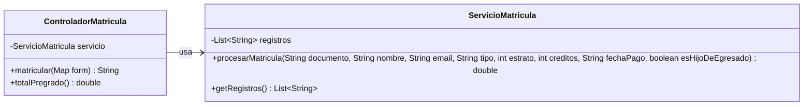

# Caso 1 · Servicio de matrícula financiera

## Contexto

La **Universidad Andina del Saber** (institución ficticia) tiene un sistema académico desarrollado internamente. El componente de matrícula financiera calcula cuánto debe pagar cada estudiante al inscribir créditos y registra la matrícula para que Tesorería pueda conciliar los pagos.

Reglas de negocio vigentes:

- Valor por crédito: pregrado $412.000, posgrado $895.000, educación continua $230.000.
- Descuento por estrato (sólo pregrado): estratos 1 y 2 tienen 40 %; estrato 3, 20 %.
- Descuento del 10 % para hijos de egresados.
- Recargo del 8 % si se paga después del 15 de enero o del 15 de julio.

## Síntomas reportados

- Tesorería informa que el reporte `totalPregrado()` **omite matrículas** cuando un estudiante escribe su nombre con punto y coma (por ejemplo, `Gómez; Ana`).
- En la última auditoría se encontró que se **registraron matrículas con tipo `"pre"`** (en minúscula) cuyo valor quedó en **$0**.
- Cada vez que cambian las tarifas, el equipo tarda días en encontrar dónde modificarlas y en probar que no se rompió nada.

## Requerimiento nuevo (próximo semestre)

Se abrirá el programa de **Tecnología** con su propia tarifa, se agregará un **descuento por convenio empresarial** (15 %) y se permitirá **pagar en tres cuotas**.

## Archivos del caso

| Archivo | Descripción |
|---|---|
| [`ServicioMatricula.java`](src/co/edu/ingsoft/caso1/ServicioMatricula.java) | Cálculo, validación, registro y notificación de la matrícula |
| [`ControladorMatricula.java`](src/co/edu/ingsoft/caso1/ControladorMatricula.java) | Recibe el formulario web y genera el reporte para Tesorería |

## Diagrama de clases actual

## Tu tarea

Sigue los pasos del [README principal](../../README.md#desarrollo-de-la-actividad-30-minutos) y completa la [plantilla](../../PLANTILLA_SOLUCION.md). Este componente contiene **al menos tres** code smells del catálogo.
