# Caso 2 · Procesamiento de pagos en una tienda virtual

## Contexto

**MercaLocal** (empresa ficticia) es una tienda virtual de productos de emprendedores colombianos. Su módulo de pagos recibe el pago del cliente al finalizar la compra (*checkout*), lo envía al medio de pago correspondiente, calcula la comisión que cobra cada proveedor y genera una línea del reporte financiero diario.

Medios de pago soportados actualmente: **tarjeta de crédito**, **débito bancario PSE** y **billetera Nequi**.

## Síntomas reportados

- El mes pasado se habilitó temporalmente una billetera digital adicional (código `"BILLETERA_X"`) para una promoción. Finanzas detectó que en el reporte esos pagos aparecían como **"Otro"**, con **comisión $0** y **acreditación en 5 días**, aunque el proveedor cobraba comisión y acreditaba al día siguiente.
- Para habilitar ese medio había que **modificar cinco métodos repartidos en tres clases**; el desarrollador sólo encontró dos.
- Los métodos del controlador reciben muchos parámetros que llegan en `null` según el medio de pago, y ya hubo un error en producción por pasar el CVV en la posición del número de tarjeta.

## Requerimiento nuevo

El área comercial quiere habilitar **Daviplata** y **tarjeta débito** antes de la temporada de fin de año, y se espera agregar más billeteras digitales en 2027.

## Archivos del caso

| Archivo | Descripción |
|---|---|
| [`ProcesadorPagos.java`](src/co/edu/ingsoft/caso2/ProcesadorPagos.java) | Valida y procesa el pago; calcula comisión y días de acreditación |
| [`ReportePagos.java`](src/co/edu/ingsoft/caso2/ReportePagos.java) | Genera la línea del reporte financiero |
| [`CheckoutController.java`](src/co/edu/ingsoft/caso2/CheckoutController.java) | Punto de entrada desde la página de pago |

## Diagrama de clases actual

```mermaid
classDiagram
    direction LR
    class CheckoutController {
        -ProcesadorPagos procesador
        -ReportePagos reporte
        +pagarConTarjeta(double monto, String moneda, String numeroTarjeta, String fechaExpiracion, String cvv) String
        +pagarConPse(double monto, String moneda, String banco) String
        +pagarConNequi(double monto, String moneda, String celular) String
        +medioHabilitado(String medioPago) boolean
    }
    class ProcesadorPagos {
        +procesar(String medioPago, double monto, String moneda, String numeroTarjeta, String fechaExpiracion, String cvv, String banco, String celular) String
        +calcularComision(String medioPago, double monto) double
        +diasParaAcreditar(String medioPago) int
    }
    class ReportePagos {
        -ProcesadorPagos procesador
        +etiqueta(String medioPago) String
        +lineaReporte(String medioPago, double monto, String moneda, String referencia) String
    }
    CheckoutController --> ProcesadorPagos
    CheckoutController --> ReportePagos
    ReportePagos --> ProcesadorPagos
```

## Tu tarea

Sigue los pasos del [README principal](../../README.md#desarrollo-de-la-actividad-30-minutos) y completa la [plantilla](../../PLANTILLA_SOLUCION.md). Este componente contiene **al menos tres** code smells del catálogo.
