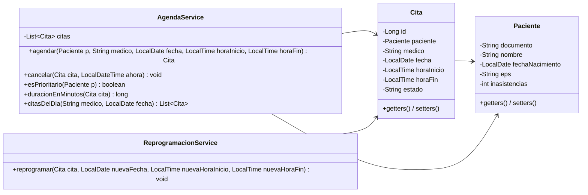

# Caso 3 · Agenda de citas médicas

## Contexto

La **IPS Salud Integral** (institución ficticia) presta servicios de consulta externa. Su sistema de agendamiento permite programar, cancelar y reprogramar citas, y lo usan tanto el portal web de pacientes como el *call center*.

Reglas de negocio vigentes:

- Un médico no puede tener dos citas que se crucen en el mismo horario.
- Si un paciente cancela con menos de 24 horas de anticipación, se le registra una inasistencia; con 3 inasistencias queda bloqueado para agendar.
- Una cita ya atendida no se puede cancelar.
- Los pacientes menores de 5 años o de 60 años o más tienen prioridad.

## Síntomas reportados

- La auditoría de calidad encontró **citas atendidas que volvieron a quedar como "PROGRAMADA"** y **médicos con dos citas en el mismo horario**. Todas fueron modificadas desde el *call center*.
- Un desarrollador nuevo escribió un reporte y comparó el estado con `"Cancelada"`; el reporte nunca encontró citas canceladas.
- Las reglas sobre citas están repartidas en varios servicios y nadie sabe con certeza cuáles se aplican en cada operación.

## Requerimiento nuevo

Se incorporarán **citas de telemedicina**: no requieren consultorio, duran 20 minutos y no generan inasistencia si se cancelan con más de 2 horas de anticipación.

## Archivos del caso

| Archivo | Descripción |
|---|---|
| [`Cita.java`](src/co/edu/ingsoft/caso3/Cita.java) | Entidad cita |
| [`Paciente.java`](src/co/edu/ingsoft/caso3/Paciente.java) | Entidad paciente |
| [`AgendaService.java`](src/co/edu/ingsoft/caso3/AgendaService.java) | Agendamiento, cancelación y consultas |
| [`ReprogramacionService.java`](src/co/edu/ingsoft/caso3/ReprogramacionService.java) | Reprogramación usada por el *call center* |

## Diagrama de clases actual

## Tu tarea

Sigue los pasos del [README principal](../../README.md#desarrollo-de-la-actividad-30-minutos) y completa la [plantilla](../../PLANTILLA_SOLUCION.md). Este componente contiene **al menos tres** code smells del catálogo.
