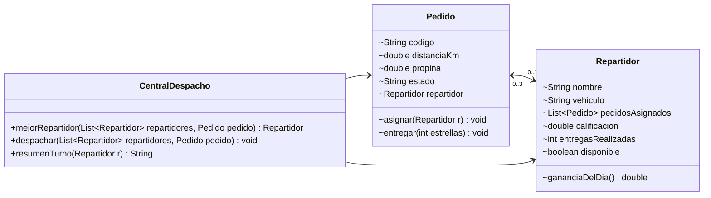

# Caso 4 · Asignación de repartidores en una app de domicilios

## Contexto

**RapiMandados** (empresa ficticia) es una aplicación de domicilios que opera en ciudades intermedias. La central de despacho asigna cada pedido al mejor repartidor disponible, registra la entrega y la calificación del cliente, y al final del turno muestra un resumen con la ganancia de cada repartidor.

Reglas de negocio vigentes:

- Un repartidor puede llevar hasta 3 pedidos al mismo tiempo.
- Las bicicletas sólo atienden pedidos de hasta 3 km; las motos, cualquier distancia.
- La ganancia es de $1.200 por km recorrido más la propina de cada pedido entregado.
- La calificación del repartidor es el promedio de las estrellas de sus entregas.

## Síntomas reportados

- Los repartidores reclaman que el resumen de turno **siempre muestra ganancia $0**, aunque hayan hecho muchas entregas.
- El panel de soporte reasigna pedidos manualmente llamando a `pedido.asignar(...)`, y así se han asignado **pedidos de 8 km a repartidores en bicicleta**.
- Cualquier cambio en `Pedido` termina rompiendo algo en `Repartidor` o en `CentralDespacho`, y no es posible probar una clase sin las otras.

## Requerimiento nuevo

Se incorporarán repartidores en **carro** para pedidos de más de 10 km, y la capacidad de pedidos simultáneos dependerá del vehículo (bicicleta 2, moto 3, carro 5).

## Archivos del caso

| Archivo | Descripción |
|---|---|
| [`Repartidor.java`](src/co/edu/ingsoft/caso4/Repartidor.java) | Datos del repartidor y ganancia del día |
| [`Pedido.java`](src/co/edu/ingsoft/caso4/Pedido.java) | Pedido, asignación y entrega |
| [`CentralDespacho.java`](src/co/edu/ingsoft/caso4/CentralDespacho.java) | Selección de repartidor y resumen de turno |

> Observa la visibilidad de los campos: la mayoría no tiene modificador de acceso (visibilidad de paquete).

## Diagrama de clases actual

## Tu tarea

Sigue los pasos del [README principal](../../README.md#desarrollo-de-la-actividad-30-minutos) y completa la [plantilla](../../PLANTILLA_SOLUCION.md). Este componente contiene **al menos tres** code smells del catálogo.
