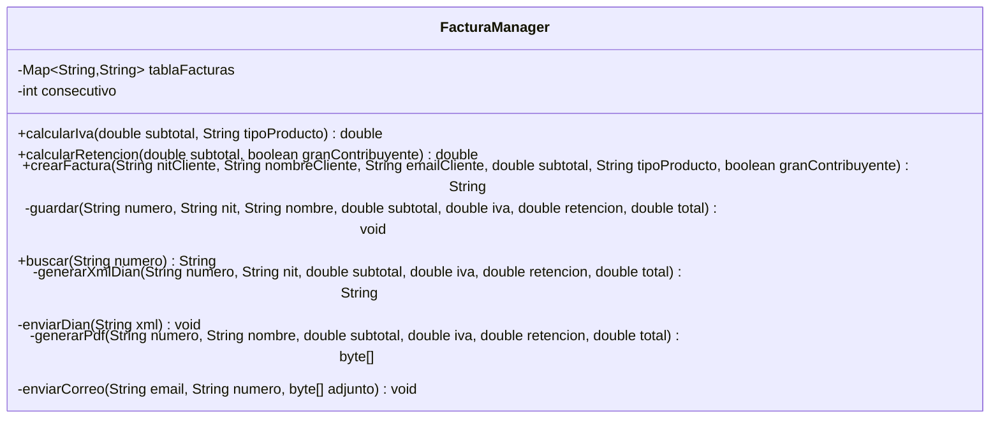

# Caso 5 · Generación de facturas electrónicas

## Contexto

**FacturaYa** (empresa ficticia) ofrece un servicio en la nube de facturación electrónica para pequeñas empresas. Al emitir una factura, el sistema calcula impuestos, la guarda, genera el documento XML que se transmite a la DIAN, produce la representación gráfica (PDF) y la envía por correo al cliente.

> Las reglas tributarias del caso están **simplificadas** con fines académicos.

Reglas vigentes:

- IVA: productos de canasta básica exentos, medicamentos 5 %, el resto 19 %.
- Retención del 2,5 % cuando el cliente es gran contribuyente y el subtotal supera la base mínima.
- Cada factura tiene un número consecutivo con prefijo `FE-`.

## Síntomas reportados

- Cuatro equipos (tributario, integración con la DIAN, plantillas PDF y base de datos) modifican `FacturaManager` casi todas las semanas. Los **conflictos de *merge*** en ese archivo son constantes.
- Un cambio en la plantilla del PDF obligó a volver a probar el cálculo de impuestos y el envío a la DIAN, porque **no es posible probar una parte sin ejecutar todo el flujo**.
- Los comentarios de la clase dicen lo mismo que el código y uno de ellos ya no coincide con lo que hace.
- Seguridad informática reportó que la consulta SQL se arma **concatenando texto ingresado por el usuario**.

## Requerimiento nuevo

La empresa debe migrar la persistencia a **PostgreSQL**, generar **PDF reales** con plantilla por cliente, y emitir **notas crédito** (que reutilizan el cálculo de impuestos y la transmisión a la DIAN).

## Archivos del caso

| Archivo | Descripción |
|---|---|
| [`FacturaManager.java`](src/co/edu/ingsoft/caso5/FacturaManager.java) | Toda la lógica de facturación |

## Diagrama de clases actual

## Tu tarea

Sigue los pasos del [README principal](../../README.md#desarrollo-de-la-actividad-30-minutos) y completa la [plantilla](../../PLANTILLA_SOLUCION.md). Este componente contiene **al menos tres** code smells del catálogo.
