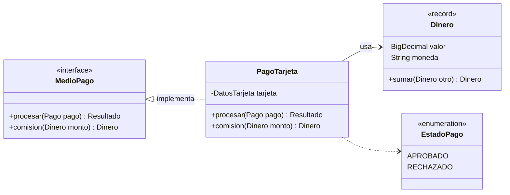

# Guía rápida: diagramas de clases en Mermaid

GitHub dibuja automáticamente los bloques que empiezan con ` ```mermaid `. Puedes probar tu diagrama en vivo en [mermaid.live](https://mermaid.live).

## Ejemplo completo



## Sintaxis esencial

| Elemento | Sintaxis |
|---|---|
| Visibilidad | `+` público · `-` privado · `#` protegido · `~` paquete |
| Atributo | `-String nombre` |
| Método | `+calcular(int x) double` |
| Genéricos | `List~Pedido~` (se usa `~` en lugar de `<>`) |
| Estereotipo | `<<interface>>`, `<<abstract>>`, `<<enumeration>>`, `<<record>>` |
| Herencia | `Padre <\|-- Hija` |
| Implementación | `Interfaz <\|.. Clase` |
| Asociación | `A --> B` (A conoce a B) |
| Composición | `Todo *-- Parte` |
| Agregación | `Todo o-- Parte` |
| Dependencia | `A ..> B` (A usa a B temporalmente) |
| Multiplicidad | `Cliente "1" --> "0..*" Pedido` |
| Etiqueta en relación | `A --> B : usa` |
| Orientación | `direction LR` (izquierda a derecha) o `direction TB` |
